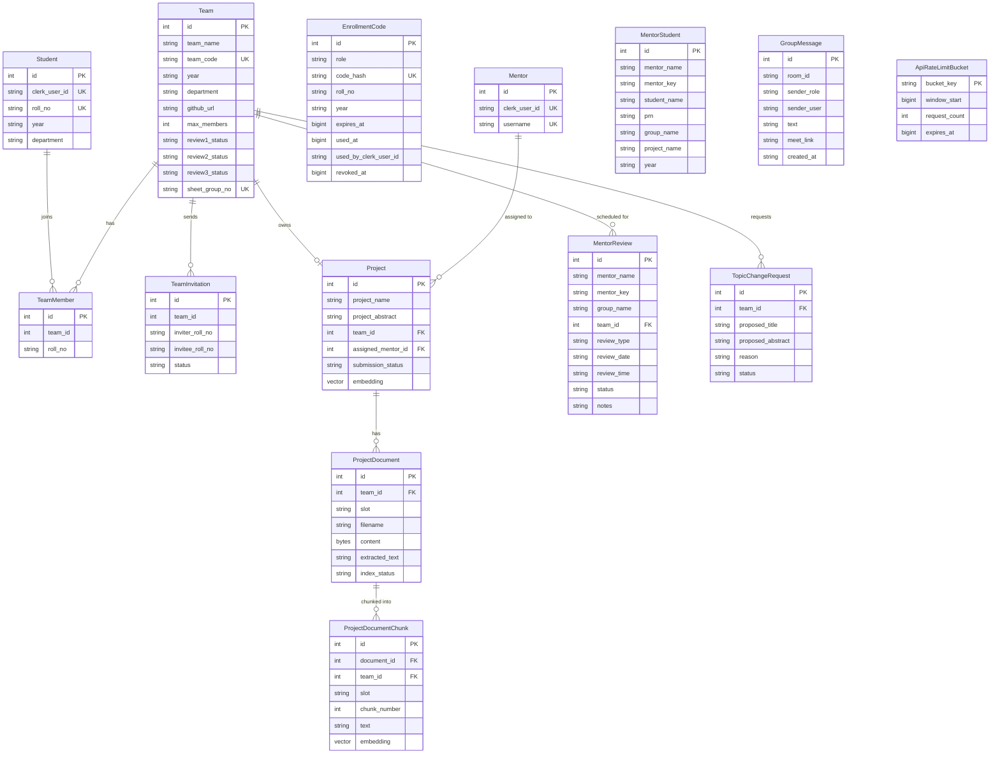
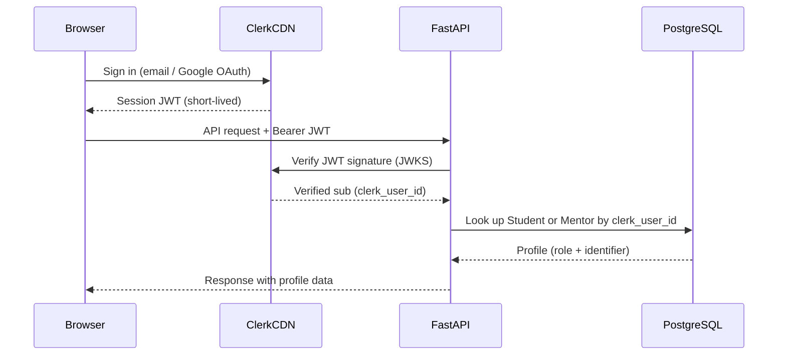
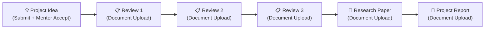

# ProjectGuard — Comprehensive Project Overview

> _Last updated: 2026-10-20_

---

## 1. What is ProjectGuard?

**ProjectGuard** is a full-stack academic project-management platform built for engineering colleges (AIML department focus). It connects three types of users — **Students**, **Mentors**, and **Admins** — through a single, secure web application.

The system handles the complete lifecycle of a college mini/major project:

- Student enrollment and team formation
- Project idea submission with real-time plagiarism detection
- Mentor assignment, review scheduling, and progress tracking
- Document upload with AI-powered RAG (Retrieval-Augmented Generation) chat
- Group messaging with Google Meet integration
- Admin control over enrollment codes and account management

---

## 2. Technology Stack

| Layer | Technology |
|-------|-----------|
| **Backend** | Python · FastAPI · SQLAlchemy ORM |
| **Database** | PostgreSQL + pgvector extension |
| **Authentication** | Clerk (JWT session tokens — no passwords stored) |
| **AI / LLM** | Groq API (model: `openai/gpt-oss-120b`) |
| **Embeddings** | Cloudflare Workers AI (Qwen3, 1024-dim vectors) |
| **NLP / Plagiarism** | NLTK · sentence-transformers · scikit-learn |
| **Document Parsing** | PyMuPDF (PDF) · python-docx (DOCX) |
| **Frontend** | Vanilla HTML + CSS + JavaScript (no framework) |
| **Icons** | Phosphor Icons |
| **Fonts** | Inter (Google Fonts) |
| **Deployment** | Render (production) · uvicorn (local) |

---

## 3. Repository Structure

```
Project_Guard/
├── main.py                    # FastAPI app — all API routes
├── models.py                  # SQLAlchemy ORM models (all tables)
├── database.py                # DB engine, session factory, initializer
├── clerk_auth.py              # Clerk JWT verification middleware
├── axiom_ai.py                # Groq LLM client — Axiom AI chatbot
├── group_connect.py           # Group messaging + review router
├── project_access.py          # Mentor project-visibility helpers
├── mentor_roster.py           # Mentor key derivation + Excel parsing
├── enrollment.py              # Enrollment code redemption logic
├── project_rag.py             # Document indexing + vector retrieval
├── team_sheet_import.py       # Excel team-sheet bulk import
├── legacy_projects.py         # Migration helpers for old data
├── migrate_sqlite_to_postgres.py  # One-time migration script
├── requirements.txt           # Python dependencies
├── build_backend.sh           # Production build script (NLTK data, etc.)
│
├── embeddings/                # Cloudflare AI embedding client
│   ├── cloudflare.py          # REST calls to Cloudflare Workers AI
│   ├── project_vectors.py     # Batch embedding + storage helpers
│   ├── chunking.py            # Text chunking for RAG
│   └── calibrate.py          # Threshold calibration utilities
│
├── nlp/                       # NLP pipeline
│   ├── extractor.py           # Document text extraction
│   ├── preprocessor.py        # NLTK tokenize / stop-word removal
│   └── plagiarism_worker.py   # Subprocess-isolated plagiarism check
│
├── Models/                    # FAISS-style vector index (legacy/offline)
│   ├── search.py              # Nearest-neighbour search
│   └── scripts/               # Index build + benchmark scripts
│
├── Frontend/                  # Pure HTML/CSS/JS frontend
│   ├── index.html             # Student portal
│   ├── mentor_index.html      # Mentor portal
│   ├── admin.html             # Admin (enrollment management) portal
│   ├── auth.html              # Student sign-in/up page
│   ├── mentor_auth.html       # Mentor sign-in/up page
│   ├── script.js              # Student portal logic
│   ├── mentor_script.js       # Mentor portal logic
│   ├── admin.js               # Admin portal logic
│   ├── group_connect.js       # Shared group-chat UI
│   ├── feedback.js            # Toast / notification system
│   ├── clerk-config.js        # Clerk browser SDK bootstrap
│   ├── portal-session-guard.js # Route protection for each portal
│   ├── auth-retry.js          # Clock-skew token retry logic
│   ├── deployment-config.js   # Runtime backend URL config
│   ├── account-actions.js     # Profile / account deletion
│   ├── style.css / admin.css / mentor_sytle.css / group_connect.css / feedback.css
│
└── plan/                      # Planning & documentation
    ├── PROJECT_OVERVIEW.md    # ← this file
    ├── Deploy.md
    ├── Security.md
    └── ...other sprint docs
```

---

## 4. Database Schema

All tables live in a single PostgreSQL database with `pgvector` enabled.



---

## 5. Authentication Flow

ProjectGuard uses **Clerk** exclusively — no password hashing is done in the app.



**First-time profile linking** (`POST /api/profile/link`):
1. User signs up on Clerk.
2. They enter their roll number + a one-time enrollment code issued by admin.
3. The backend verifies the code, creates a `Student` row, and links it to their `clerk_user_id`.
4. Same flow for mentors using a mentor enrollment code.

---

## 6. User Roles & Portals

### 6.1 Student Portal (`index.html`)

| Section | Feature |
|---------|---------|
| **Dashboard** | Project progress bar (0–6 milestones), GitHub repository card |
| **Submit Project** | Enter title + abstract, upload PDF/DOCX/TXT (≤ 20 MB), real-time plagiarism check, submit for mentor review |
| **My Project** | View current project details, assigned mentor, review status; upload review documents (R1/R2/R3); request topic change |
| **Find Your Team** | Create a team (unique code generated), join via team code, send/accept/decline invitations, leave team |
| **Group Connect** | Per-group chat room with mentor, share Google Meet links, view scheduled reviews |

### 6.2 Mentor Portal (`mentor_index.html`)

| Section | Feature |
|---------|---------|
| **Dashboard** | Stats: assigned students, project idea submissions, pending/completed reviews; recent activity feed; schedule review button |
| **Project List** | Table of all teams with year filter (SE/TE/BE), search, view project details modal (abstract, progress, documents), accept/reject submission, Axiom AI chat per project |
| **Student List** | Import students via Excel `.xlsx`, add manually, edit student details, view submissions, replace all teams |
| **Group Connect** | Chat with groups, share/schedule Google Meet links, schedule reviews inline |

### 6.3 Admin Portal (`admin.html`)

| Section | Feature |
|---------|---------|
| **Enrollment codes** | Generate one-time codes for student or mentor enrollment, with identity verification method recorded; codes expire (configurable hours); shown once then hidden |
| **Code management** | List latest 200 codes with status (active / used / revoked / expired); revoke any code |
| **Account management** | List all student/mentor accounts; delete account (removes Clerk identity + profile, preserves academic records) |

---

## 7. Core Features In-Depth

### 7.1 Plagiarism Detection

- **Trigger:** Student clicks "Check Plagiarism" or submits a project.
- **Pipeline:**
  1. File uploaded → text extracted by `nlp/extractor.py` (PyMuPDF / python-docx).
  2. Text chunked and preprocessed (NLTK stop-word removal, tokenization).
  3. A subprocess worker (`nlp/plagiarism_worker.py`) is spawned to isolate CPU work; killed after 90-second timeout.
  4. The project's embedding (Cloudflare Qwen3, 1024-dim) is compared against all existing project embeddings in PostgreSQL via cosine similarity.
  5. An `originality_score` (0–100 %) is returned and displayed as a color-coded chip.
- **Hard-block threshold:** If `ORIGINALITY_BLOCK_THRESHOLD` env var is set, submissions above the threshold are rejected.
- **Concurrency guard:** A PostgreSQL advisory lock ensures only one check runs at a time across all workers.

### 7.2 Axiom AI — Student Chatbot (`/chat-stream`)

- Streamed text generation via Groq API (SSE-style streaming).
- System prompt: "Axiom AI" — academic assistant focused on project originality, plagiarism risk, and improvement suggestions.
- Rate limited to 8 requests / minute per user, 120 / minute per IP.
- Context includes the student's project title, abstract, and any uploaded document passages.

### 7.3 Mentor Axiom AI (`/mentor/axiom-stream`)

- Same Groq backend but with a mentor-scoped system prompt.
- Mentor can ask questions about any of their assigned projects.
- Multi-turn conversation history (up to 8 turns) is passed in each request.

### 7.4 Mentor Project Chat — RAG (`/mentor/project-chat`)

- Document-grounded Q&A per team.
- When a team uploads a review document, it is chunked → embedded (Cloudflare) → stored in `project_document_chunks` as 1024-dim pgvector rows.
- On each mentor question: the question is embedded → top-k similar chunks are retrieved by cosine similarity → passed as "passages" in the LLM prompt.
- Sources are returned alongside the answer with slot + filename labels.

### 7.5 Group Connect (Real-time Messaging)

- REST-based message polling (no WebSockets).
- Room identity is derived from `(mentor_key, group_number)` — ensures only the assigned mentor and group members can see each room.
- Google Meet link sharing: validated against regex `https://meet.google.com/[a-z]{3}-[a-z]{4}-[a-z]{3}`.
- PostgreSQL `SHARE MODE` table lock during message send/read to prevent race conditions during team imports.

### 7.6 Team System

- **Create team:** Generates a random unique team code (alphanumeric).
- **Join team:** Via team code; capacity enforced by `max_members` (default 4).
- **Invitations:** Invite by roll number; accept/decline system.
- **Leave team:** If last member leaves and no project exists, team is deleted automatically.
- **GitHub URL:** Validated to be a strict `https://github.com/owner/repo` format.
- **Roster sync:** When a student joins/leaves a team, the `mentor_students` roster is automatically updated to reflect the correct mentor assignment.

### 7.7 Enrollment Code System

- Codes are random secrets; only the SHA-256 hash is stored (`code_hash`).
- Codes are scoped to a specific roll number + year (students) or mentor name (mentors).
- One-time use — redeemed code is marked with timestamp and Clerk user ID.
- Configurable expiry (1–168 hours).
- Admin records the verification method used (official roster / institutional contact / in person).

### 7.8 Review Scheduling

- Mentor picks group + date + time + review type (Progress Review-1, Progress Review-2, Final Presentation).
- Scheduled reviews appear in the Group Connect chat room for both mentor and students.
- Mentor can mark reviews as "completed" or "cancelled".
- Review status feeds into the student dashboard progress tracker (3 review milestones out of 6 total).

### 7.9 Project Progress Milestones

Students see a progress bar with 6 checkpoints:

| # | Milestone | Trigger |
|---|-----------|---------|
| 1 | Project idea | Project submitted and accepted |
| 2 | Review 1 | `review1_status = submitted` |
| 3 | Review 2 | `review2_status = submitted` |
| 4 | Review 3 | `review3_status = submitted` |
| 5 | Research paper | Research paper document uploaded |
| 6 | Project report | Project report document uploaded |

### 7.10 Topic Change Request

- Students can propose a new project title + abstract + reason for change.
- Mentor sees the request in the project details modal.
- Mentor can accept (project title/abstract updated) or reject the request.

---

## 8. Security Design

### Rate Limiting

All sensitive endpoints are rate-limited with **dual counters** — one per Clerk user ID and one per client IP:

| Endpoint | User limit | Window | IP limit |
|----------|-----------|--------|---------|
| `/check-plagiarism` | 3 | 60 s | 30 |
| `/submit-project` | 3 | 60 s | 30 |
| `/chat-stream` | 8 | 60 s | 120 |
| `/mentor/axiom-stream` | 5 | 60 s | 60 |
| `/api/admin/enrollments` | 30 | 60 s | 120 |
| `/api/profile/link` | 5 | 1 h | 100 |

Rate counters are stored in PostgreSQL (`api_rate_limit_buckets`) and are shared across all API workers. Bucket keys are HMAC-SHA256 hashed to avoid leaking user/IP data.

### Middleware Security

- All routes (except `/api/config`, OpenAPI docs) require a valid Clerk JWT.
- Legacy password routes (`/login`, `/signup`) return `410 Gone`.
- CORS: exact origin matching only; wildcards forbidden in production; HTTPS enforced.
- Trusted proxy IP ranges (`TRUSTED_PROXY_IPS`) required in production for correct IP extraction from `X-Forwarded-For`.
- Production startup validation: enforces `pk_live_` / `sk_live_` Clerk keys, independent `RATE_LIMIT_HASH_KEY`, and matching CORS + Clerk authorized parties.

### Data Isolation

- Mentors can only see projects explicitly assigned to them.
- Students can only see their own team's data and their group's chat room.
- Group Connect rooms are keyed on mentor + group assignment — unassigned users cannot access any room.
- Academic records (project data, review records) are intentionally preserved even when a user's account is deleted.

---

## 9. API Reference (Key Endpoints)

### Public

| Method | Path | Description |
|--------|------|-------------|
| `GET` | `/api/config` | Returns Clerk publishable key for frontend bootstrap |

### Profile

| Method | Path | Description |
|--------|------|-------------|
| `GET` | `/api/me` | Return current user's role + identifier |
| `POST` | `/api/profile/link` | Link Clerk account to student/mentor profile using enrollment code |
| `DELETE` | `/api/account` | Delete own account (Clerk + app profile) |

### Team (Students)

| Method | Path | Description |
|--------|------|-------------|
| `POST` | `/create-team` | Create a new team |
| `POST` | `/join-team` | Join via team code |
| `GET` | `/get-student-team` | Get current team info |
| `POST` | `/leave-team` | Leave current team |
| `PATCH` | `/my-team/github` | Update team GitHub URL |
| `POST` | `/team-invitations` | Invite a student by roll number |
| `GET` | `/team-invitations` | List pending invitations |
| `PATCH` | `/team-invitations/{id}` | Accept / decline invitation |

### Project (Students)

| Method | Path | Description |
|--------|------|-------------|
| `POST` | `/submit-project` | Submit project idea (title + abstract + optional file) |
| `POST` | `/check-plagiarism` | Run plagiarism check without submitting |
| `POST` | `/project-progress` | Upload review document for a specific slot |
| `POST` | `/topic-change-request` | Request a project topic change |

### AI Chat

| Method | Path | Description |
|--------|------|-------------|
| `GET` | `/chat-stream` | Streaming Axiom AI chat (students) |
| `POST` | `/mentor/axiom-stream` | Streaming Axiom AI per project (mentors) |
| `POST` | `/mentor/project-chat` | RAG-based document Q&A per team (mentors) |

### Mentor

| Method | Path | Description |
|--------|------|-------------|
| `GET` | `/mentor/students` | List assigned students |
| `POST` | `/mentor/students` | Add a student manually |
| `PATCH` | `/mentor/students/{id}` | Edit student details |
| `DELETE` | `/mentor/students/{id}` | Remove student from roster |
| `POST` | `/mentor/students/import` | Bulk import students from Excel |
| `POST` | `/mentor/teams/import` | Replace all teams from Excel |
| `GET` | `/mentor/projects` | List projects visible to mentor |
| `PATCH` | `/api/projects/{id}/assign` | Accept (assign) a project |
| `PATCH` | `/api/projects/{id}/reject` | Reject a project submission |
| `GET` | `/mentor/reviews` | List scheduled reviews |
| `POST` | `/mentor/reviews` | Schedule a review |
| `PATCH` | `/mentor/reviews/{id}` | Update review status |
| `GET` | `/mentor/topic-changes` | List pending topic change requests |
| `PATCH` | `/mentor/topic-changes/{id}` | Accept or reject topic change |
| `GET` | `/mentor/project-documents/{team_id}` | List uploaded documents for a team |

### Group Connect

| Method | Path | Description |
|--------|------|-------------|
| `GET` | `/group-connect/groups` | List user's assigned groups |
| `GET` | `/group-connect/messages` | Fetch messages for a group room |
| `POST` | `/group-connect/messages` | Send a message or Meet link |

### Admin

| Method | Path | Description |
|--------|------|-------------|
| `POST` | `/api/admin/enrollments` | Issue a new enrollment code |
| `GET` | `/api/admin/enrollments` | List recent codes (latest 200) |
| `DELETE` | `/api/admin/enrollments/{id}` | Revoke a code |
| `GET` | `/api/admin/accounts` | List student/mentor accounts |
| `DELETE` | `/api/admin/accounts/{id}` | Delete an account |

---

## 10. Environment Variables

| Variable | Required | Description |
|----------|----------|-------------|
| `CLERK_SECRET_KEY` | ✅ | Clerk backend secret (`sk_live_…` in prod) |
| `NEXT_PUBLIC_CLERK_PUBLISHABLE_KEY` | ✅ | Clerk publishable key (`pk_live_…` in prod) |
| `CLERK_AUTHORIZED_PARTIES` | ✅ prod | Comma-separated exact frontend HTTPS origins |
| `CORS_ALLOWED_ORIGINS` | ✅ prod | Same as above (must match authorized parties) |
| `GROQ_API_KEY` | ✅ | Groq LLM API key |
| `GROQ_MODEL` | optional | Override Groq model (default: `openai/gpt-oss-120b`) |
| `CLOUDFLARE_ACCOUNT_ID` | ✅ | Cloudflare account for Workers AI embeddings |
| `CLOUDFLARE_API_TOKEN` | ✅ | Cloudflare API token |
| `DATABASE_URL` | ✅ | PostgreSQL connection string |
| `ENROLLMENT_ADMIN_CLERK_USER_IDS` | ✅ prod | Comma-separated Clerk user IDs allowed to access admin portal |
| `RATE_LIMIT_HASH_KEY` | ✅ prod | Independent secret ≥ 32 chars for HMAC rate-limit keys |
| `TRUSTED_PROXY_IPS` | ✅ prod | CIDR ranges of the reverse proxy |
| `ORIGINALITY_BLOCK_THRESHOLD` | optional | Plagiarism score 0–100 above which submissions are blocked |
| `APP_ENV` | optional | Set to `production` to enable all prod checks |

---

## 11. Git Branches

| Branch | Purpose |
|--------|---------|
| `main` | Stable production branch |
| `Authentication` | Clerk auth implementation |
| `Security` | Rate limiting, CORS, proxy hardening |
| `Project-List` | Mentor project list features |
| `Report` | IEEE paper / logbook |

---

## 12. Project Progress Checkpoints (Academic)

The platform tracks the following six-milestone project lifecycle:



Each completed milestone increments the progress percentage shown on the student dashboard.

---

## 13. Key Design Decisions

| Decision | Rationale |
|----------|-----------|
| **Clerk for auth** | No password storage, secure MFA, social login (Google), easy admin |
| **PostgreSQL + pgvector** | Single DB for relational + vector data; shared across workers |
| **Plagiarism in subprocess** | Isolates CPU-heavy NLP; can be killed at timeout without affecting the API |
| **REST over WebSockets** | Simpler deployment on Render; acceptable for polling-based chat |
| **Enrollment codes** | Prevents unauthorized sign-ups; admin controls who can register |
| **Cloudflare for embeddings** | Low-latency, no GPU needed on API server |
| **Vanilla JS frontend** | No build step required; easy to host as static files |
| **Academic data preserved on account delete** | Project records stay for institutional audit trails |

---

## 14. Local Development Quick-Start

```bash
# 1. Install dependencies
pip install -r requirements.txt
python -m nltk.downloader punkt stopwords

# 2. Copy and fill in env vars
cp .env.example .env   # add your Clerk, Groq, Cloudflare, DB keys

# 3. Start the API (auto-creates tables on first run)
uvicorn main:app --reload --port 8000

# 4. Serve the frontend
cd Frontend
python -m http.server 5500
# or use VS Code Live Server on port 5500
```

> [!IMPORTANT]
> In development, the frontend must run on `http://localhost:5500` or `http://127.0.0.1:5500` — these are the default authorized Clerk parties and CORS origins.

---

## 15. Deployment (Render)

Refer to [`Deploy.md`](Deploy.md) for the full guide. Key points:

- Run `build_backend.sh` as the build command (installs deps + downloads NLTK data).
- Set all production env vars listed in Section 10.
- `APP_ENV=production` triggers all security checks at startup.
- The frontend can be deployed to any static hosting (Netlify, Cloudflare Pages, etc.).
- Set `deployment-config.js` to point to your Render API URL.

---

_This document is auto-generated from codebase analysis. Update it alongside significant feature changes._
